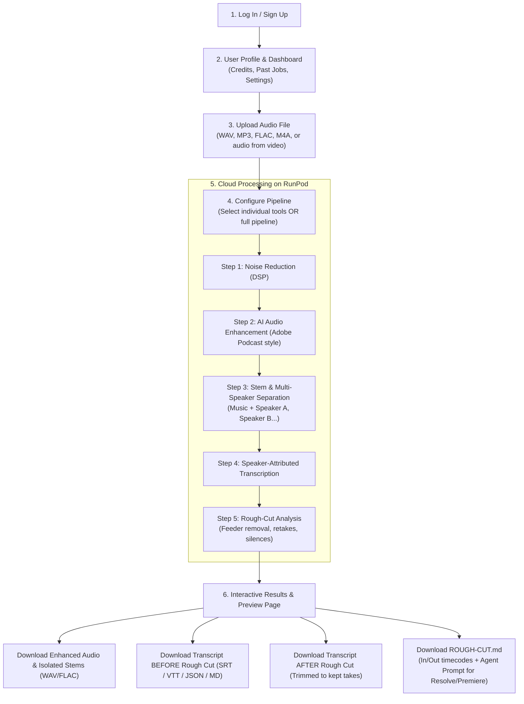

# PARECUT

## AI Audio Engineering & Rough-Cut SaaS (v1 Web Application)

**Software Requirements Specification (SRS) & Technical Architecture**

| | |
|---|---|
| **Document version** | 3.1 (RunPod GPU provider update) |
| **Supersedes** | v1.0, v1.1, v2.0 |
| **Date** | 2026-11-05 |
| **Last updated** | 2026-11-07 |
| **Status** | Ready for implementation |
| **Release Scope** | v1: All-in-one Cloud SaaS · v2 (Future): Open-source local client & live NLE plugins |
| **Primary Stack** | Python (FastAPI + SQLAlchemy/SQLModel + Pydantic) + RunPod Serverless GPUs |

---

## 0. Document Control & Scope Shift

### 0.1 Why v3.0?

Previous iterations (v1.x–v2.0) coupled the initial launch with a heavy desktop client (Tauri/Rust), local offline model management, and live NLE plugins. **v3.0 scopes v1 strictly to a high-leverage, Python-native, all-in-one Web Application.**

| Area | v2.0 (Previous) | v3.0 (Current v1 Scope) |
|---|---|---|
| **Primary Deliverable** | Cloud SaaS + Tauri Desktop Client + NLE Plugins | **All-in-one Web Application** (Auth, Profile, Pipeline, Downloads) |
| **Backend Stack** | Next.js / TypeScript / tRPC / Drizzle | **FastAPI (Python 3.12)** — unified language with RunPod and AI audio tooling |
| **Rough-Cut Delivery** | Live NLE IPC/WebSockets & OTIO plugins | **Rough-Cut Specification (`ROUGH-CUT.md`)** with exact In/Out timecodes & agent instructions, ready to hand to any coding agent (Claude Code, Codex, Cursor) to generate Resolve/Premiere scripts |
| **Downloadable Artifacts** | Stems + single transcript | **Enhanced audio, isolated stems (music + per-speaker), raw transcript (before cut), trimmed transcript (after cut), and `ROUGH-CUT.md`** |
| **Desktop Client & Offline** | In v1 | **Deferred to v2** (the Python `parecut-engine` is structured cleanly so v2 can wrap it later) |

### 0.2 GPU Provider Update (2026-11-07)

GPU inference will run on **RunPod Serverless**, not Modal. The architecture, schema field names, webhook path, and deployment notes below reflect RunPod. The Phase 1 web shell and mock pipeline are unaffected. The decision record is `docs/adr/0001-runpod-gpu-inference.md`.

---

## 1. Product Overview

### 1.1 Vision & Value Proposition

Parecut is an AI audio engineering and rough-cut preparation platform built for professional video producers, editors, and sound engineers.

Most automated rough-cut tools fail on real-world shoots because they transcribe **raw, noisy, single-mic audio**. When an off-camera director or "feeder" reads lines to an on-camera presenter, or when room echo and background music bleed into the mic, raw transcription produces a wall of duplicate, unattributed text that confuses both editors and LLMs.

Parecut solves this by running a modular **audio-first pipeline** in the cloud:

1. **Noise Reduction (DSP):** Clean out room hum, hiss, clicks, and level the signal.
2. **Voice Enhancement & Augmentation:** Studio-grade neural dereverberation and voice restoration (Adobe Podcast-style clarity).
3. **Stem & Multi-Speaker Separation:** Split background music from dialogue, and separate multiple people speaking into the **same microphone** into discrete, phase-aligned speaker tracks.
4. **Speaker-Attributed Transcription:** Word-level, forced-aligned transcripts where every line is tagged by speaker.
5. **Rough-Cut Markdown Spec (`ROUGH-CUT.md`):** An intelligent rough-cut analysis that outputs a structured Markdown file containing exact In/Out timecodes, frame numbers, speaker roles (e.g., Feeder vs. Presenter), keep/remove decisions, and a ready-to-run prompt block so the editor's coding agent can generate a DaVinci Resolve or Premiere Pro cut script in seconds.

### 1.2 Target User (v1)

Professional video creators and editors who:
- Already work in DaVinci Resolve, Premiere Pro, or Final Cut Pro.
- Need studio-clean stems and isolated speaker tracks from challenging shoots (single mic, off-camera line feeder, noisy rooms).
- Already use coding agents (Claude, ChatGPT, Cursor, Codex) and want clean audio + an exact, frame-accurate cut specification they can turn into an NLE timeline script or use directly.

---

## 2. End-to-End User Experience (v1 Web Flow)



### 2.1 Step-by-Step Flow

1. **Authentication & Profile**
   - User signs up or logs in (Email/Password or Google/GitHub OAuth).
   - User lands on their **Profile & Projects Dashboard**, showing credit balance, active/past audio jobs, and default project settings (e.g., default frame rate like `24`, `25`, `29.97`, `30`, `60` fps for timecode formatting).
2. **Audio Upload**
   - User uploads an audio file (`.wav`, `.flac`, `.mp3`, `.m4a`, `.aac`) or drops a video container from which the browser/server extracts the audio track.
   - Direct presigned upload to Cloudflare R2 for fast, large-file handling.
3. **Flexible Pipeline Selection**
   - The user can run **a single tool** or **chain any combination** into a pipeline:
     - `[x] Noise Reduction` (DSP spectral gating, de-hum, de-click, loudness normalization)
     - `[x] AI Voice Enhancement` (Neural dereverb + bandwidth restoration, with a 0–100% mix slider)
     - `[x] Stem & Speaker Separation` (Isolate music/background + split multiple voices on the same mic into separate tracks)
     - `[x] Transcription` (Word-level timestamps + speaker labels)
     - `[x] Generate Rough-Cut Plan` (Identify feeder lines, false starts, retakes, and dead air; requires Transcription)
4. **Speaker Tagging (Optional Quick Step or Auto)**
   - When multiple speakers are detected, the user can either let the AI auto-classify `PRESENTER` vs. `FEEDER` (based on repetition patterns and acoustic dominance) or click to label `Speaker 1 = Presenter`, `Speaker 2 = Feeder (Remove)` in the UI and re-generate the Rough-Cut Markdown instantaneously (no GPU re-run needed).
5. **Downloads & Deliverables**
   - **Audio Artifacts:**
     - `enhanced_full.wav` — Denoised and AI-enhanced full track.
     - `stem_music.wav` / `stem_dialogue.wav` — Separated music and dialogue stems.
     - `speaker_01_presenter.wav`, `speaker_02_feeder.wav` — Sample-aligned isolated speaker tracks.
   - **Transcription Artifacts:**
     - **Before Rough Cut (`transcript_raw.*`):** Full verbatim transcript of the original recording with speaker tags and exact timestamps (`.md`, `.json`, `.srt`, `.vtt`).
     - **After Rough Cut (`transcript_cut.*`):** Clean transcript containing **only the kept segments**, provided in two timestamp modes:
       1. *Source Timecode* (where the kept lines live in the original file).
       2. *Assembled Timeline Timecode* (continuous timestamps `00:00:00.000 → end` as they will play after the cuts are made).
   - **The Rough-Cut Specification (`ROUGH-CUT.md`):**
     - A self-contained, human- and LLM-readable Markdown specification detailing every Keep and Remove segment with exact `HH:MM:SS.mmm` and frame-accurate `HH:MM:SS:FF` In/Out points, plus a copy-paste prompt template so the user's coding agent can immediately output a working DaVinci Resolve Python script or Premiere ExtendScript/UXP script.

---

## 3. Technical Architecture (Python-First All-in-One Stack)

### 3.1 Why FastAPI + Python End-to-End?

Because the core audio processing, AI orchestration (RunPod), DSP (librosa/pedalboard/ffmpeg), and LLM rough-cut logic are all Python, building the web backend in **FastAPI** eliminates language boundaries:

- **Single language (`Python 3.12`)** across web API, database models, background tasks, and RunPod GPU workers.
- **Shared Pydantic schemas** between FastAPI endpoints, database JSON columns, and RunPod worker inputs/outputs — zero codegen or TypeScript/Python drift.
- **Faster iteration** for a solo/Python-focused builder.

### 3.2 Technology Stack Table

| Layer | Technology | Role & Justification |
|---|---|---|
| **Backend & Web App** | **FastAPI (Python 3.12)** | All-in-one backend: REST API, SSE progress streams, webhooks, and UI serving |
| **Frontend UI** | **React (Vite + TypeScript + Tailwind) served statically by FastAPI** *(or Jinja2 + HTMX + Alpine.js — see §3.3)* | Single deployable unit; clean audio player (Wavesurfer.js), pipeline toggles, and download center |
| **Database & ORM** | **PostgreSQL + SQLModel (SQLAlchemy 2.0 + Pydantic) + Alembic** | Users, profiles, credits, jobs, stage checkpoints, and transcripts |
| **Cache & Realtime** | **Redis** | Worker progress heartbeats, SSE pub/sub, rate limiting |
| **Authentication** | **FastAPI Users / Authlib (JWT + Session Cookies + OAuth)** | Login, signup, profile management, password reset |
| **Object Storage** | **Cloudflare R2 (boto3 S3 client)** | Zero-egress storage for uploaded audio, stems, transcripts, and `.md` exports |
| **Serverless GPU** | **RunPod Serverless (`runpod` Python SDK + REST API)** | Endpoint invocation (`/run` + `/status`) from FastAPI; GPU type configured per endpoint |
| **Audio & AI Runtime** | **PyTorch, CUDA 12.x, ffmpeg, Pedalboard / DeepFilterNet / Demucs / Pyannote / MossFormer2 / Whisper** | Runs inside RunPod worker images via shared `parecut_engine` package |
| **Rough-Cut LLM** | **LiteLLM / OpenAI / Anthropic Python SDK** | Runs inside FastAPI (or CPU worker) to analyze speaker-attributed transcripts and emit `ROUGH-CUT.md` |

### 3.3 All-in-One Monorepo Structure

```text
parecut/
├── pyproject.toml                 # Single workspace (uv / poetry)
├── alembic/                       # DB migrations
├── app/                           # FastAPI all-in-one application
│   ├── main.py                    # FastAPI entrypoint + static SPA mount
│   ├── config.py                  # Pydantic Settings
│   ├── auth/                      # Login, OAuth, session/JWT dependencies
│   ├── users/                     # Profile, credits, user preferences (FPS, etc.)
│   ├── jobs/                      # Job creation, pipeline config, SSE progress, downloads
│   ├── roughcut/                  # Before/After transcript generator + ROUGH-CUT.md builder
│   ├── webhooks/                  # RunPod HMAC callback receiver
│   ├── storage.py                 # boto3 R2 presigned PUT/GET helpers
│   └── db.py                      # Async SQLAlchemy / SQLModel session
├── parecut_engine/                # Pure Python audio & ML pipeline logic
│   ├── schemas.py                 # Shared Pydantic models (JobConfig, Transcript, CutPlan)
│   ├── dsp.py                     # Stage 1: Traditional noise reduction & leveling
│   ├── enhance.py                 # Stage 2: Neural voice enhancement / dereverb
│   ├── separate.py                # Stage 3a: Music / vocal stem splitting
│   ├── speakers.py                # Stage 3b: Diarization + single-mic multi-speaker extraction
│   ├── transcribe.py              # Stage 4: Whisper ASR + forced word alignment
│   └── cut_planner.py             # Stage 5: Feeder/presenter rules + LLM take selector
├── runpod_app/                    # Serverless GPU deployment
│   └── worker.py                  # RunPod serverless handlers around parecut_engine
└── web/                           # Frontend UI (built & mounted by FastAPI at /)
```

### 3.4 System Data Flow

```
Browser
  │  1. Login (Cookie/JWT) & view Profile
  │  2. Request presigned upload URL ──► FastAPI ──► R2 presigned PUT
  │  3. Upload audio directly to R2
  │  4. POST /api/jobs (selected pipeline steps + FPS)
  ▼
FastAPI Backend
  ├─ Validates audio metadata via ffprobe (duration, channels, sample rate)
  ├─ Creates Job row in Postgres & reserves user credits
  ├─ Submits a RunPod /run request (job_id, pipeline_config) and stores runpod_job_id
  │
  ▼
RunPod Serverless Workers (imports parecut_engine)
  ├─ [Step 1: Clean]      CPU/L4   ──► jobs/{id}/01_cleaned.wav
  ├─ [Step 2: Enhance]    L4 GPU   ──► jobs/{id}/02_enhanced.wav
  ├─ [Step 3: Separate]   A10G GPU ──► jobs/{id}/stems/{music,dialogue,spk_01,spk_02}.wav
  ├─ [Step 4: Transcribe] L4 GPU   ──► jobs/{id}/04_transcript_raw.json
  ├─ [Step 5: Rough Cut]  CPU/LLM  ──► jobs/{id}/05_cut_plan.json
  │                                    + 05_transcript_before.{md,srt,json}
  │                                    + 05_transcript_after.{md,srt,json}
  │                                    + ROUGH-CUT.md
  │
  ├─ FastAPI polls RunPod status or receives a signed callback, then relays progress to SSE
  └─ On completion FastAPI settles credits and marks the job Ready
```

---

## 4. Detailed Pipeline & Feature Specifications

### 4.1 Stage 1 — Noise Reduction (Traditional DSP)

- **Purpose:** Fast, artifact-free cleanup of stationary background noise, electrical hum, mouth clicks, and uneven volume before hitting neural models.
- **Capabilities:**
  - High-pass filter (rumble removal below 70–80 Hz).
  - Notch filtering for 50 Hz / 60 Hz mains hum and harmonics.
  - Spectral gating noise reduction (stationary room tone / A/C fan noise).
  - De-click and de-ess pass.
  - EBU R128 loudness normalization (default `-16 LUFS` for video/podcasts, `-1 dBTP` true peak).
- **Output:** `01_cleaned.wav` (48 kHz, 24-bit WAV or FLAC, exact sample count of source).

### 4.2 Stage 2 — AI Audio Augmentation & Enhancement ("Studio Voice")

- **Purpose:** Transform boxy, reverberant, or off-axis microphone recordings into close-mic studio quality (similar to Adobe Podcast Enhance Speech).
- **Capabilities:**
  - Neural dereverberation and room echo removal.
  - Voice bandwidth extension (reconstructing missing high/low frequencies from compressed or distant mics).
  - **Wet/Dry Mix parameter (`0%–100%`, default `80%`):** Blends the enhanced neural signal with the Stage 1 DSP-cleaned signal so professionals can retain natural room character if desired.
- **Output:** `02_enhanced.wav` (sample-aligned with source).

### 4.3 Stage 3 — Stem & Multi-Speaker Separation (Single-Mic)

- **Purpose:** Untangle complex audio into clean component tracks so music doesn't ruin transcription and overlapping/secondary voices (like an off-camera line feeder) are isolated from the main presenter.
- **Sub-stage 3a — Music / Background Separation (Demucs-class):**
  - Splits audio into `dialogue_vocals.wav` and `background_music_fx.wav`.
- **Sub-stage 3b — Single-Mic Multi-Speaker Separation:**
  - **Diarization (Pyannote-class):** Runs on the full dialogue track to build a global speaker map (`SPEAKER_01`, `SPEAKER_02`, …) and extracts speaker embeddings.
  - **Target-Speaker Extraction (MossFormer2 / SpeakerBeam-class):**
    - Emits one full-length, sample-aligned audio file per speaker (`speaker_01.wav`, `speaker_02.wav`).
    - In non-overlapping regions, routes the clean enhanced voice directly; in overlapping regions (e.g., the feeder finishing a prompt while the presenter starts speaking), runs neural target-speaker extraction conditioned on each speaker's embedding so the presenter's take isn't ruined.
- **Invariant:** Every output stem has the **exact duration and sample count** of the original uploaded file, so dropping them onto parallel tracks in Resolve or Premiere lines up to the frame.

### 4.4 Stage 4 — Speaker-Attributed Transcription

- **Purpose:** Produce a word-accurate transcript where every word and sentence is tied to a specific speaker (`SPEAKER_01`, `SPEAKER_02`) and exact sample/timecode boundaries.
- **Capabilities:**
  - Transcribes the cleaned/separated speaker tracks using `Whisper large-v3-turbo` (or `large-v3`).
  - Runs forced phoneme/word alignment (`wav2vec2` / `whisperX`-style alignment) so word start/end times are accurate to within ≤ 40 ms (one video frame), avoiding raw Whisper timestamp drift.
  - Merges speaker turns chronologically into a unified, speaker-attributed transcript.

### 4.5 Stage 5 — Rough-Cut Engine & `ROUGH-CUT.md` Generator

This stage turns the speaker-attributed transcript and acoustic silence map into **actionable editing deliverables**:

1. **Speaker Role Detection (Auto + User Override):**
   - Automatically identifies if a **Feeder / Presenter** pattern exists (e.g., `SPEAKER_02` says a line, followed by `SPEAKER_01` repeating it one or more times) or if it is a single-speaker / multi-host shoot.
   - Users can also toggle speaker roles (`Keep / Presenter`, `Remove / Feeder`, `Keep / Co-host`) in the web UI and regenerate the Markdown files in < 2 seconds without re-running GPUs.
2. **Deterministic + LLM Cut Planning:**
   - **Rule Pass:** Marks all `Feeder` segments, long dead-air silences (> `0.8s`, leaving a configurable `150ms` breath pad), and noise-only gaps as `REMOVE`.
   - **LLM Take Selection Pass:** Groups presenter attempts under each feeder prompt (or groups consecutive repeated sentences in single-speaker shoots). Evaluates takes for completeness, false starts, stumbles, and tangents, marking the best take as `KEEP` and failed/earlier attempts as `REMOVE (Retake / False Start)`.
   - **Frame Snapping:** Snaps all cut boundaries to the user's selected video frame rate (`24`, `25`, `29.97`, `30`, `60` fps) inside low-energy acoustic windows so cuts never clip a consonant.
3. **Dual Transcript Generation (Before & After):**
   - **Before Rough Cut (`transcript_before.*`):** Every spoken segment (including feeder lines and retakes) with original timestamps.
   - **After Rough Cut (`transcript_after.*`):** Only the `KEEP` segments, showing both **Original Source Timecodes** and **New Cut Timeline Timecodes** (how the video reads after ripple-deleting all removed sections).

---

## 5. Specification of `ROUGH-CUT.md` (The Agent-Ready Deliverable)

Because v1 delegates NLE execution to the user's coding agent (Claude Code, Cursor, Codex, ChatGPT), `ROUGH-CUT.md` is designed to be **both immediately clear to a human editor and 100% unambiguous to an LLM writing a DaVinci Resolve or Premiere Pro script**.

### 5.1 Structure of `ROUGH-CUT.md`

````markdown
# PARECUT ROUGH-CUT SPECIFICATION

## 1. Source Media & Timeline Metadata
- **Source Filename:** `A001_C014_interview.mov` (or `.wav`)
- **Duration:** `00:14:32.400` (`872.400s` / `21810 frames @ 25 fps`)
- **Frame Rate:** `25.0 fps`
- **Sample Rate:** `48000 Hz`
- **Estimated Duration After Cut:** `00:06:18.120` (`56.7% removed`)
- **Recommended Audio Track:** `speaker_01_presenter_enhanced.wav`

## 2. Speaker Map
| Speaker ID | Assigned Role | Action | Notes |
|---|---|---|---|
| `SPEAKER_01` | **Presenter** | `KEEP (Best Takes)` | On-camera talent |
| `SPEAKER_02` | **Feeder / Director** | `REMOVE ALL` | Off-camera line prompts |

---

## 3. Machine-Readable Cut List (Keep Segments — For NLE Timeline Assembly)
> **Note for Coding Agents:** Building a rough-cut timeline is safest and cleanest by appending the `KEEP` ranges below in order onto a new timeline (ripple assembly), rather than making destructive in-place razor deletes from back to front. Both tables (`KEEP` and `REMOVE`) are provided below so you can use whichever approach the host NLE API prefers.

### 3.1 `KEEP` Ranges (Assemble in Order)
| # | Source In (TC) | Source Out (TC) | Source In (Sec) | Source Out (Sec) | In Frame | Out Frame | New Timeline TC | Speaker | Text |
|---|---|---|---|---|---|---|---|---|---|
| 1 | `00:00:08:12` | `00:00:11:04` | `8.480` | `11.160` | `212` | `279` | `00:00:00:00` | `SPEAKER_01` | "Today we're going to talk about three-point lighting." |
| 2 | `00:00:19:02` | `00:00:24:18` | `19.080` | `24.720` | `477` | `618` | `00:00:02:17` | `SPEAKER_01` | "The key light is your primary light source on set." |

### 3.2 `REMOVE` Ranges (Trimmed / Cut Out from Original)
| # | Source In (TC) | Source Out (TC) | Source In (Sec) | Source Out (Sec) | In Frame | Out Frame | Reason | Speaker | Transcript / Detail |
|---|---|---|---|---|---|---|---|---|---|
| 1 | `00:00:00:00` | `00:00:02:14` | `0.000` | `2.560` | `0` | `64` | `SILENCE` | — | Pre-roll dead air |
| 2 | `00:00:02:14` | `00:00:05:08` | `2.560` | `5.320` | `64` | `133` | `FEEDER_PROMPT` | `SPEAKER_02` | "Today we're going to talk about three-point lighting." |
| 3 | `00:00:05:08` | `00:00:08:12` | `5.320` | `8.480` | `133` | `212` | `FALSE_START` | `SPEAKER_01` | "Today we're gonna— sorry, let me go again." |
| 4 | `00:00:11:04` | `00:00:15:10` | `11.160` | `15.400` | `279` | `385` | `FEEDER_PROMPT` | `SPEAKER_02` | "The key light is your primary light source on set." |
| 5 | `00:00:15:10` | `00:00:19:02` | `15.400` | `19.080` | `385` | `477` | `OLDER_TAKE` | `SPEAKER_01` | "The key light is the main light source." *(Superseded by Take #2)* |

---

## 4. Full Chronological Audit Log (Every Segment)
- `[00:00:00.000 - 00:00:02.560]` ❌ **REMOVE (SILENCE)**
- `[00:00:02.560 - 00:00:05.320]` ❌ **REMOVE (FEEDER — SPEAKER_02):** "Today we're going to talk about three-point lighting."
- `[00:00:05.320 - 00:00:08.480]` ❌ **REMOVE (FALSE_START — SPEAKER_01):** "Today we're gonna— sorry, let me go again."
- `[00:00:08.480 - 00:00:11.160]` ✅ **KEEP (BEST_TAKE — SPEAKER_01):** "Today we're going to talk about three-point lighting."

---

## 5. Ready-to-Use Coding Agent Instructions
> Copy this file into your coding agent (Claude Code, Cursor, Codex, ChatGPT) and ask:
> - *"Write a DaVinci Resolve Python script (`DaVinciResolveScript`) that creates a new timeline named `Rough Cut` and appends the `KEEP` frame ranges from Section 3.1 using `mediaPool.AppendToTimeline`."*
> - *"Write an Adobe Premiere Pro ExtendScript (`.jsx`) or UXP script that builds a new sequence from the `KEEP` ranges in Section 3.1."*
> - *"Generate an FCPXML 1.10 or OpenTimelineIO (`.otio`) file from Section 3.1 that I can import directly into Resolve, Premiere, or Final Cut Pro."*
````

---

## 6. Database Schema & API Design (FastAPI)

### 6.1 Core Database Tables (PostgreSQL + SQLModel)

1. **`users`**
   - `id (UUID)`, `email`, `hashed_password`, `oauth_provider`, `full_name`, `avatar_url`, `created_at`
2. **`user_profiles`**
   - `user_id (FK)`, `credit_balance_minutes (Numeric)`, `default_fps (str: "24"|"25"|"29.97"|"30"|"60")`, `default_enhance_mix (int: 80)`, `default_silence_pad_ms (int: 150)`
3. **`credit_ledger`**
   - `id`, `user_id (FK)`, `job_id (FK nullable)`, `delta_minutes (Numeric)`, `reason ("signup_bonus"|"purchase"|"job_reserve"|"job_settle"|"job_refund")`, `gpu_seconds_internal (Float)`, `created_at`
4. **`jobs`**
   - `id (UUID)`, `user_id (FK)`, `status ("queued"|"running"|"completed"|"failed"|"canceled")`, `source_filename`, `source_r2_key`, `duration_seconds (Float)`, `sample_rate (Int)`, `fps (Str)`
   - `pipeline_config (JSONB)`: `{ "noise_reduction": true, "enhance": true, "enhance_mix": 0.8, "separate_music": true, "separate_speakers": true, "transcribe": true, "rough_cut": true }`
   - `speaker_roles (JSONB)`: `{ "SPEAKER_01": "presenter", "SPEAKER_02": "feeder" }`
   - `runpod_job_id (Str)`, `error_code (Str nullable)`, `created_at`, `completed_at`
5. **`job_artifacts`**
   - `id (UUID)`, `job_id (FK)`, `kind ("cleaned_audio"|"enhanced_audio"|"stem_music"|"stem_dialogue"|"stem_speaker"|"transcript_before"|"transcript_after"|"rough_cut_md")`, `label (Str)`, `format ("wav"|"flac"|"md"|"srt"|"vtt"|"json")`, `r2_key (Str)`, `size_bytes (BigInt)`

### 6.2 Core FastAPI Endpoints

| Method | Path | Description |
|---|---|---|
| `POST` | `/api/auth/register` · `/api/auth/login` · `/api/auth/oauth/{provider}` | User authentication |
| `GET/PATCH` | `/api/profile` | View profile, credit balance, job history, update default FPS & audio preferences |
| `POST` | `/api/uploads/presign` | Returns a presigned R2 `PUT` URL + `upload_key` for direct browser upload |
| `POST` | `/api/jobs` | Validates uploaded file, reserves credits, and submits the selected pipeline to RunPod |
| `GET` | `/api/jobs/{job_id}` | Job details, stage statuses, detected speakers, and downloadable artifact list |
| `GET` | `/api/jobs/{job_id}/events` | Server-Sent Events (SSE) stream for real-time stage & percentage progress |
| `PATCH` | `/api/jobs/{job_id}/speakers` | Re-assign speaker roles (e.g. mark `SPEAKER_02` as `feeder`) and **instantly regenerate** `ROUGH-CUT.md` and `transcript_after.*` on the FastAPI server without re-running GPU stages |
| `GET` | `/api/jobs/{job_id}/download/{artifact_id}` | Returns a signed R2 download URL (`Content-Disposition: attachment`) or bundles selected files as a `.zip` |
| `POST` | `/api/webhooks/runpod` | HMAC-verified callback from RunPod workers reporting stage completion, artifacts, and internal GPU-seconds |

---

## 7. RunPod Serverless GPU Architecture

### 7.1 Endpoint & GPU Mapping

Because the user can toggle any subset of the pipeline, FastAPI submits only the requested stages. RunPod configures the GPU type per endpoint.

| Pipeline Step | RunPod Compute | Model Candidates (Benchmark in Phase 0) | Runs When |
|---|---|---|---|
| **Orchestrator & Ingest** | CPU in FastAPI | `ffmpeg`, `ffprobe`, VAD chunk planner | Every job |
| **1. Noise Reduction** | CPU in FastAPI | `pedalboard` / `scipy` / `noisereduce` + `ffmpeg` EBU R128 | `noise_reduction = true` |
| **2. AI Enhancement** | `parecut-audio`, **L4 GPU** (or T4) | `DeepFilterNet3` / `Resemble Enhance` / `VoiceFixer` | `enhance = true` |
| **3a. Music Separation** | `parecut-separate`, **A10G GPU** (or L4) | `htdemucs_ft` (vocals vs. other) | `separate_music = true` |
| **3b. Speaker Separation** | `parecut-separate` / `parecut-audio`, **L4 or A10G** | `pyannote 3.1` (diarization) + `MossFormer2` / `ClearerVoice-Studio` (TSE) | `separate_speakers = true` |
| **4. Transcription** | `parecut-audio`, **L4 GPU** | `faster-whisper (large-v3-turbo)` + `wav2vec2` forced alignment | `transcribe = true` or `rough_cut = true` |
| **5. Rough-Cut & Markdown** | CPU in FastAPI + LLM API | `parecut_engine.cut_planner` (Rules + LLM take selector) | `rough_cut = true` |

### 7.2 Key Operational Rules

1. **Endpoint per GPU class:** `parecut-audio` (L4) handles enhancement, diarization, and transcription. `parecut-separate` (A10G) handles music separation and target-speaker extraction. Weights are baked into the image or mounted read-only from a RunPod network volume and loaded once in the worker handler. This avoids paying multiple cold starts on a single job.
2. **Backend-driven orchestration:** `RunPodPipelineRunner` implements `PipelineRunner`. It submits `/run`, stores `runpod_job_id`, polls `/status/{id}` or accepts a signed callback, updates `stage_states`, and publishes `JobEvent`s. Workers never connect to Postgres.
3. **Storage contract:** FastAPI issues short-lived presigned R2 GET and PUT URLs. Workers receive URLs, never R2 credentials.
4. **Sample-Exact Outputs:** Every audio stage preserves the exact sample length of the input file so stems and original video never drift out of sync.
5. **Full-File Diarization:** Diarization runs on the full audio file (up to 3 hours) so `SPEAKER_01` and `SPEAKER_02` never swap identities mid-file.
6. **Re-cutting is Free & Instant:** Once Stage 4 (`transcript_raw.json`) is saved in Postgres/R2, changing speaker roles, silence thresholds, or FPS in the web UI re-runs Stage 5 directly inside FastAPI in seconds, updating `ROUGH-CUT.md` and `transcript_after.*` with zero GPU cost.
7. **24-Hour Retention Sweep:** An hourly background task in FastAPI deletes raw uploads and heavy WAV stems from R2 24 hours after job completion (with a 2-day R2 lifecycle rule as a safety net), while optionally keeping the lightweight `.md` and transcript text files in the user's profile history.
8. **Scale-to-zero with FlashBoot:** Keep `workersMin = 0` until paid volume justifies a warm worker. Enable FlashBoot on both endpoints.

### 7.3 RunPod Request Contract

FastAPI submits the job and outputs contract to the selected endpoint:

```json
{
  "input": {
    "job_id": "uuid",
    "stages": ["enhance", "transcribe"],
    "fps": "25",
    "enhance_mix": 0.8,
    "inputs": { "source": "<presigned R2 GET URL>" },
    "outputs": { "enhanced": "<presigned R2 PUT URL>", "transcript": "<presigned R2 PUT URL>" }
  },
  "webhook": "https://app.parecut.example/api/webhooks/runpod"
}
```

The worker downloads and uploads through those URLs, reports progress with `runpod.serverless.progress_update`, and returns artifact metadata plus GPU seconds. When a worker calls back to FastAPI, the callback is HMAC-SHA256 signed with a shared secret. FastAPI remains the only process that reads or writes Postgres.

---

## 8. Functional & Non-Functional Requirements Summary

### 8.1 Functional Requirements (v1)

- **FR-AUTH-01:** Users can sign up, log in, log out, and manage their profile (name, default frame rate, audio preferences, credit balance, and job history).
- **FR-UPL-01:** Users can upload audio files (or video files for audio track extraction) up to 3 hours in length via presigned R2 uploads.
- **FR-PIP-01:** Users can select individual features or run the complete pipeline (Noise Reduction → Enhancement → Music/Speaker Separation → Transcription → Rough Cut).
- **FR-AUD-01:** Users can preview original vs. enhanced audio and isolated speaker stems directly in the browser before downloading.
- **FR-CUT-01:** When Rough Cut is enabled, the system outputs:
  1. `transcript_before` (full verbatim transcript with speaker tags and timestamps in `.md`, `.srt`, `.vtt`, `.json`).
  2. `transcript_after` (trimmed transcript of kept takes only, with both source and post-cut timestamps).
  3. `ROUGH-CUT.md` containing exact In/Out timecodes, seconds, and frame numbers for every kept and removed segment, plus copy-paste coding-agent instructions for DaVinci Resolve and Premiere Pro.
- **FR-CUT-02:** Users can reassign speaker roles (`Presenter / Keep`, `Feeder / Remove`, `Co-host / Keep`) in the web UI and immediately regenerate `ROUGH-CUT.md` and `transcript_after`.

### 8.2 Non-Functional Requirements (v1)

- **NFR-PERF-01:** Cold start on RunPod L4/A10G ≤ 25 s (p95); end-to-end full pipeline for a 30-minute recording finishes in ≤ 5 minutes (p50).
- **NFR-QLT-01:** Word boundary alignment error ≤ 40 ms (1 frame at 25 fps) so cuts generated from `ROUGH-CUT.md` do not clip words.
- **NFR-COST-01:** Blended cloud COGS ≤ $0.35 per source-hour for the full pipeline; scale-to-zero (`workersMin = 0`) until paid volume justifies a warm worker.
- **NFR-SEC-01:** All R2 uploads and downloads use presigned URLs (≤ 15-min TTL); worker callbacks are verified via HMAC-SHA256.

---

## 9. Implementation Plan (v1 Web Application)

### Phase 0 — Audio & Model Benchmark on RunPod (Week 1)
- Set up the `parecut` Python repo (`uv`) and `runpod_app/worker.py`.
- Test the 4 core stages (`dsp`, `enhance`, `separate + speakers`, `transcribe + align`) on 3–5 real recordings (including a feeder/presenter recording and a noisy single-mic clip).
- Verify output quality, sample-exact alignment, and measure exact RunPod GPU-seconds per minute of audio.
- Verify commercial licenses of the chosen model weights (e.g., `DeepFilterNet3` / `Resemble Enhance`, `ClearerVoice-Studio` / `MossFormer2`, `pyannote`, `faster-whisper`).

### Phase 1 — Core Engine & `ROUGH-CUT.md` Generator (Week 2)
- Implement `parecut_engine/cut_planner.py`:
  - Feeder/presenter detection & rule pass (silence + feeder removal).
  - LLM take-selection pass (grouping presenter retakes under feeder lines and picking the best take).
  - Frame-accurate timecode converter (`24`, `25`, `29.97`, `30`, `60` fps).
  - Markdown & SRT/VTT/JSON renderers for `transcript_before`, `transcript_after`, and `ROUGH-CUT.md`.
- **Validation test:** Give the generated `ROUGH-CUT.md` to Claude / Cursor / Codex, ask it for a DaVinci Resolve Python script and a Premiere script, and run the generated script on the original clip in your editor to confirm the cuts land cleanly.

### Phase 2 — FastAPI Backend, Auth, Profile & Storage (Week 3)
- Build the FastAPI application (`app/`):
  - Postgres + SQLModel tables (`users`, `user_profiles`, `jobs`, `job_artifacts`, `credit_ledger`).
  - Auth (Login / Signup / OAuth) and User Profile endpoints.
  - R2 presigned upload & download endpoints.
  - Job creation endpoint that submits the RunPod pipeline and streams progress via SSE.
  - Speaker-role override endpoint (`PATCH /api/jobs/{id}/speakers`) that regenerates `ROUGH-CUT.md` and `transcript_after` on the fly.

### Phase 3 — Web UI, Audio Player & Launch Polish (Weeks 4–5)
- Build the web interface (mounted directly by FastAPI):
  - **Login & Profile Dashboard:** Job history, credit balance, default FPS selector.
  - **New Job / Upload Screen:** Drag-and-drop audio upload + checkboxes to run a single step or the full pipeline.
  - **Job Results Screen:**
    - Synchronized A/B audio player (original vs. enhanced vs. isolated speaker stems).
    - Speaker role switcher (`Presenter` vs. `Feeder`).
    - Tabbed viewer & one-click download buttons for:
      - **Enhanced Audio & Stems** (`.wav` / `.flac`)
      - **Transcript (Before Cut)** (`.md` / `.srt` / `.json`)
      - **Transcript (After Cut)** (`.md` / `.srt` / `.json`)
      - **`ROUGH-CUT.md`** (with a "Copy for Coding Agent" button + `.md` download)
- Add Stripe credit top-up and launch v1.

### Phase 4 (Future v2 Release) — Open-Source Local Client & Native NLE Plugins
- Wrap `parecut_engine` into the downloadable desktop client with offline model downloads and direct DaVinci Resolve / Premiere Pro plugin panels that execute the Cut Plan automatically without needing the intermediate Markdown step.

---

*End of document — v3.0, 2026-11-05.*
